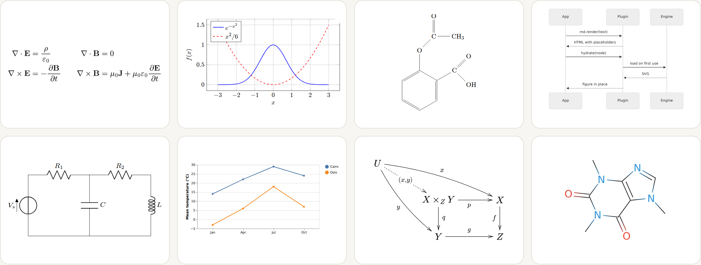
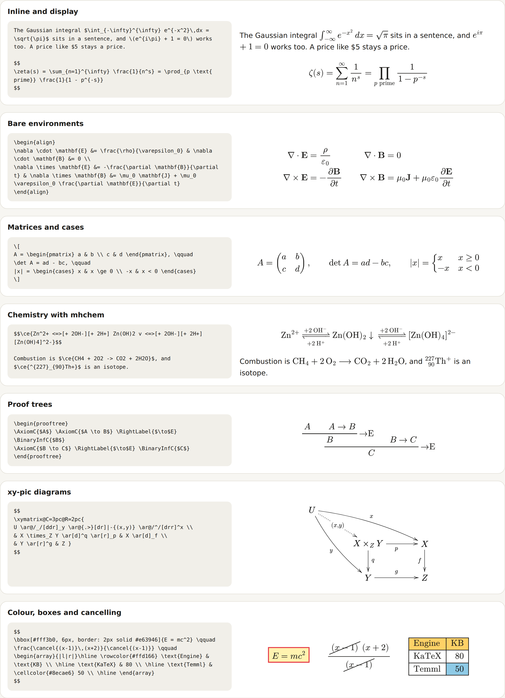
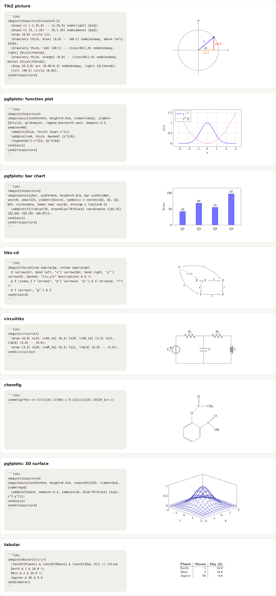
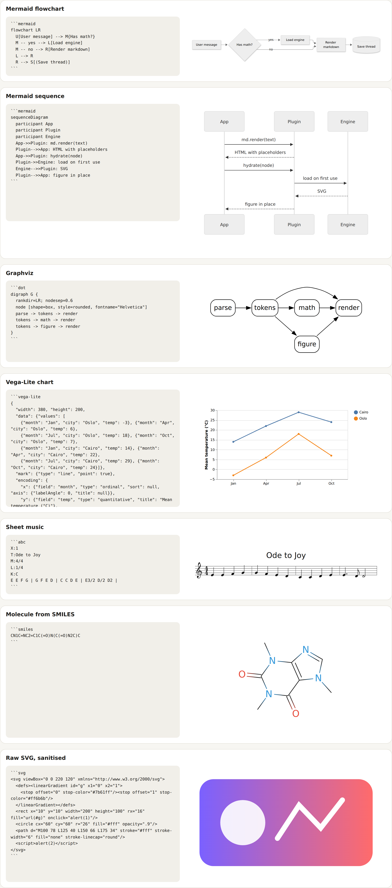

# markdown-it-latex-plus

Serious LaTeX for [markdown-it](https://github.com/markdown-it/markdown-it), plus the figures an AI agent wants to draw: TikZ, plots, circuits, chemistry, diagrams, charts, sheet music and molecules.

<a href="https://markdown-it-latex-plus.pages.dev"></a>

**[Live gallery and playground →](https://markdown-it-latex-plus.pages.dev)**

## Prompt for your agent

Give this to any model whose Markdown you render with the plugin, so it knows what it can use. It is also exported as `prompt`.

```
Your Markdown is rendered with LaTeX and figures.
Math (MathJax 4): $inline$ or \(inline\); $$display$$ or \[display\] on their own lines. Write \$ for a literal dollar. \ce{} for chemical equations, \xymatrix for xy-pic.
Fenced code blocks that render as figures:
- tikz: a tikzpicture, pgfplots axis, tikzcd, circuitikz or \chemfig (body only, no preamble)
- mermaid: flowcharts, sequence, gantt and other Mermaid diagrams
- dot: Graphviz
- vega-lite: a chart as a JSON spec with inline data
- abc: sheet music
- smiles: a molecule as a SMILES string
- svg: raw SVG
```

## Install

```sh
npm i markdown-it-latex-plus
```

Not on npm yet. Until it is, install from GitHub: `npm i github:sune-org/markdown-it-latex-plus`.

## Use

In the browser, `md.render()` stays synchronous and `hydrate()` fills in whatever is new:

```js
import MarkdownIt from 'markdown-it'
import latexPlus from 'markdown-it-latex-plus'

const md = MarkdownIt().use(latexPlus)

node.innerHTML = md.render(text)
md.latexPlus.hydrate(node)
```

Call both after every chunk while a reply streams. Finished formulas and figures come back from the cache, so nothing flickers, and a fenced block is only drawn once its closing fence arrives.

On the server, math is typeset in Node; figures are sent as their source and drawn by `hydrate()` on the client:

```js
const html = await md.latexPlus.render(text)
const css = md.latexPlus.css()
```

## What it renders

### LaTeX math

MathJax 4, with the packages people reach for already switched on.

- **Delimiters:** `$…$`, `\(…\)`, `$$…$$`, `\[…\]`, and bare `\begin{align}…\end{align}` blocks with no delimiters at all. Prose like "costs $5 and $10" is left alone.
- **Packages:** AMS, mathtools, mhchem (`\ce`), cancel, color, colortbl, bussproofs, amscd, braket, enclose, cases, empheq, units, bbm, dsfont, upgreek, gensymb, textcomp, and xy-pic (`\xymatrix`). `physics` is one option away.
- **MathJax 4 extras:** automatic line breaking of long inline math, `\parbox`, `\newcolumntype`, `\begingroup`, `\char`.
- **Errors** show the source with the reason on hover instead of breaking the page.

<details>
<summary>See the math gallery</summary>

</details>

### TikZ and friends

Real TeX, compiled to WebAssembly, running in the browser. A `tikz` block accepts a bare picture or a whole document; the packages it needs are worked out from the source.

- TikZ pictures, pgfplots (function plots, bar charts, 3D surfaces), tikz-cd, circuitikz, chemfig, tikz-3dplot, and `tabular`.
- The engine (about 7 MB) is fetched the first time a figure needs it; a figure then takes roughly 0.2 to 9 seconds, and is cached.

<details>
<summary>See the TikZ gallery</summary>

</details>

### Diagrams, charts and more

| Fence | Draws | Library |
|---|---|---|
| `mermaid` | flowcharts, sequence, gantt, class, state… | Mermaid |
| `dot` | graphs with automatic layout | Graphviz (viz-js) |
| `vega-lite` | charts from a JSON spec | Vega-Lite |
| `abc` | sheet music | abcjs |
| `smiles` | a molecule from one line of text | SmilesDrawer |
| `svg` | raw SVG, with scripts and handlers removed | DOMPurify |

Each library is fetched only when a block first needs it.

<details>
<summary>See the figures gallery</summary>

</details>

## Built for model output

- **Safe by default.** MathJax runs with its `safe` extension; every figure is sanitised before it is cached or shown; charts cannot fetch remote data. See [security](security.md).
- **Forgiving.** Whole LaTeX documents, stray `\usepackage` lines and bare environments are all handled.
- **Streaming-friendly.** One cache serves every re-render; unclosed blocks stay as code.

## Options

```js
md.use(latexPlus, {
  delimiters: 'all',              // 'all' | 'dollars' | 'brackets'
  environments: true,             // bare \begin{align}…\end{align}
  blocks: { mermaid: false },     // switch individual fences off
  packages: ['physics'],          // extra MathJax packages
  macros: { RR: '\\mathbb{R}' },
  libs: { mermaid: () => import('mermaid') },   // bring your own copy instead of the CDN
})
```

Everything else is in the docs:

- [Syntax](syntax.md): delimiters, rules and limits
- [Figures](figures.md): every fenced block, with examples
- [API](api.md): options, methods, server rendering, custom blocks
- [Engines](engines.md): versions, sizes, licences, self-hosting
- [Security](security.md): what is sanitised and how it is tested

## Development

```sh
npm install && npm test          # Node tests
cd site && npm install && npm run dev
node scripts/e2e.js              # browser tests against the running site
node scripts/shots.js            # redraw the images in this README
```

## Licence

See [LICENSE](../LICENSE). The engines it loads at runtime keep their own licences, listed in [engines](engines.md).
