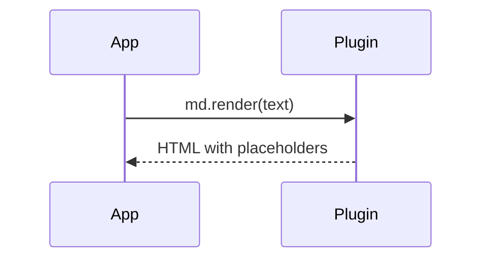
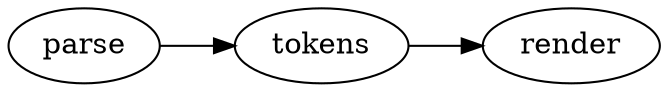

# Figures

A fenced code block whose language is one of the names below is drawn as a figure. Everything is rendered in the browser by `hydrate()`; on the server these blocks are emitted as placeholders holding the source.

While a block is being typed (no closing fence yet) it stays an ordinary code block. If a figure cannot be drawn, the source is shown with the reason underneath.

| Fence | Also accepted |
|---|---|
| `tikz` | `pgfplots`, `tikzcd`, `circuitikz`, `chemfig` |
| `mermaid` | |
| `dot` | `graphviz` |
| `vega-lite` | `vegalite` |
| `abc` | `abcjs` |
| `smiles` | |
| `svg` | |

Switch any of them off with `blocks: { name: false }`.

## tikz

Real TeX compiled to WebAssembly ([TikZJax](engines.md#tikz)).

````md
```tikz
\begin{tikzpicture}
\begin{axis}[xlabel=$x$, ylabel=$f(x)$, domain=-3:3, samples=60]
  \addplot[blue, thick] {exp(-x^2)};
\end{axis}
\end{tikzpicture}
```
````

What you can put in the block:

- A bare `tikzpicture`, `tikzcd`, `circuitikz`, or a `\chemfig{…}`.
- A whole document. `\documentclass`, `\begin{document}` and `\end{document}` are removed.
- `\usepackage{…}` and `\usetikzlibrary{…}` lines anywhere; they are moved to the preamble.
- Plain LaTeX with no picture, such as a `tabular`. It is placed inside a TikZ node.

Packages are added automatically when the source uses them: `pgfplots` (with `compat=1.16` unless you set it), `tikz-cd`, `circuitikz`, `chemfig`, `tikz-3dplot`, `array`, `amsmath`, `amssymb`. Those are also the only packages available; a `\usepackage` for anything else is dropped.

The first figure on a page waits for the engine to download (about 7 MB, cached by the browser). Each figure then takes roughly 0.2 to 9 seconds depending on how much TeX has to compute; 3D plots are the slow ones. Results are kept in the plugin's cache and in the browser's IndexedDB.

Known limits: only the packages listed above, and no `\includegraphics`.

## mermaid

````md

````

Every Mermaid diagram type works. Mermaid runs with `securityLevel: 'strict'` and the `neutral` theme; change either with the `mermaid` option, which is passed to `mermaid.initialize`.

## dot

````md

````

Graphviz, compiled to WebAssembly. Pass `dot: { engine: 'neato' }` to use another layout engine.

## vega-lite

````md
```vega-lite
{
  "data": {"values": [{"q": "Q1", "v": 42}, {"q": "Q2", "v": 68}]},
  "mark": "bar",
  "encoding": {"x": {"field": "q", "type": "nominal"}, "y": {"field": "v", "type": "quantitative"}}
}
```
````

The block holds a Vega-Lite spec as JSON; a full Vega spec (with a Vega `$schema`) works too. Data must be inline: a spec that asks for a URL is refused, because the spec may have been written by a model. Supply your own `vega.loader` to allow it.

## abc

````md
```abc
X:1
T:Ode to Joy
M:4/4
L:1/4
K:C
E E F G | G F E D | C C D E | E3/2 D/2 D2 |
```
````

[ABC notation](https://abcnotation.com/), drawn by abcjs. Options go in `abc`.

## smiles

````md
```smiles
CC(N)Cc1ccccc1
```
````

One molecule (here amphetamine) as a [SMILES](https://en.wikipedia.org/wiki/Simplified_Molecular_Input_Line_Entry_System) string. `smiles: { width, height, theme }` adjusts the drawing.

For reaction equations use `\ce{…}` in math; for hand-drawn structures use `\chemfig` in a `tikz` block.

## svg

````md
```svg
<svg viewBox="0 0 100 40" xmlns="http://www.w3.org/2000/svg">
  <rect width="100" height="40" rx="8" fill="#4b3aa8"/>
</svg>
```
````

Raw SVG, passed through DOMPurify: scripts, event handlers, `javascript:` links and foreign HTML are removed.

## Your own blocks

```js
md.use(latexPlus, {
  renderers: {
    qr: { render: async text => `` },
  },
})
```

A renderer returns HTML, which is inserted as is. Sanitise it yourself if the block's source is not trusted.
